# A2 – ns-3 Setup & Traffic Model

### QoS Performance Analysis of 5G Non-Terrestrial Networks

**Advanced Network QoS | Technical Study Notes**

---

## Project Overview

This report documents the installation, configuration, troubleshooting, and initial application of the ns-3 network simulator.

A particular focus is placed on the unsuccessful initial WSL2 installation, the subsequent Windows recovery, and the successful migration to a cloud-based Linux development environment using GitHub Codespaces.

The report also presents the implementation and verification of a custom stochastic UDP traffic generator as an initial foundation for the planned 5G Non-Terrestrial Network (NTN) QoS analysis.

### Project Information

| Property | Details |
|:---|:---|
| Assignment | A2 – ns-3 Setup & Traffic Model |
| Project | QoS Performance Analysis of 5G NTN |
| Simulator | ns-3.46 |
| Operating System | Ubuntu 24.04.5 LTS |
| Development Environment | GitHub Codespaces |
| Programming Languages | C++, Python |
| Traffic Protocol | UDP |
| Analysis Tools | Python, Wireshark |
| Completion Date | October 13, 2026 |

### Implementation Status

| Milestone | Status |
|:---|:---|
| Initial local WSL2 installation | Failed – documented |
| Alternative Linux environment | Completed |
| ns-3 configuration and compilation | Completed |
| Built-in simulation test | Completed |
| Custom traffic generator | Completed |
| Packet capture generation | Completed |
| Wireshark verification | Completed |
| Packet-size PDF and CDF | Completed |
| Inter-arrival-time PDF and CDF | Completed |
| Full 3GPP traffic-model validation | Future work |
| NTN-specific network simulation | Future work |

---

## Table of Contents

1. [Project Objective](#1-project-objective)
2. [Initial Installation Attempt – Windows and WSL2](#2-initial-installation-attempt--windows-and-wsl2)
3. [Alternative Setup – GitHub Codespaces](#3-alternative-setup--github-codespaces)
4. [Python Compatibility Issue](#4-python-compatibility-issue)
5. [Building and Testing ns-3](#5-building-and-testing-ns-3)
6. [Custom Traffic Model](#6-custom-traffic-model)
7. [Generated Simulation Results](#7-generated-simulation-results)
8. [PDF and CDF Verification](#8-pdf-and-cdf-verification)
9. [PCAP Verification Using Wireshark](#9-pcap-verification-using-wireshark)
10. [Problems Encountered and Solutions](#10-problems-encountered-and-solutions)
11. [Current Limitations](#11-current-limitations)
12. [Conclusion](#12-conclusion)
13. [Repository Structure](#13-repository-structure)

---

# 1. Project Objective

The objective of this assignment was to establish a working ns-3 simulation environment and implement an initial traffic model as a foundation for the subsequent investigation of Quality of Service (QoS) in 5G Non-Terrestrial Networks (NTN).

The assignment included:

- Installing and compiling ns-3.
- Documenting the installation process and encountered problems.
- Implementing and executing a traffic generator.
- Generating packet captures for inspection in Wireshark.
- Verifying packet-size and inter-arrival-time distributions using PDF and CDF plots.

A significant part of this assignment involved troubleshooting an unsuccessful initial installation and migrating to an alternative development environment.

---

# 2. Initial Installation Attempt – Windows and WSL2

The initial approach was to install Ubuntu through Windows Subsystem for Linux (WSL2), allowing ns-3 to run locally without replacing the existing Windows operating system.

Windows PowerShell was opened with administrator privileges, and the following command was executed:

```powershell
wsl --install
```

The installation downloaded and installed Windows Subsystem for Linux version 3.0.1. Windows subsequently enabled the optional `VirtualMachinePlatform` component and requested a system restart.

The installation procedure reported successful completion before the restart.

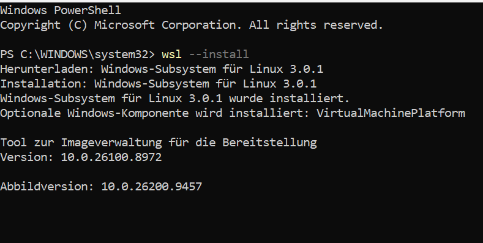

*Figure 1: Initial installation of Windows Subsystem for Linux using PowerShell.*

## 2.1 Critical Installation Failure

Following the required restart, Windows failed to boot correctly. Restoring normal operation required a Windows system reset.

Although the failure occurred immediately after the WSL installation process, its exact root cause could not be established. Therefore, the incident is documented as a temporal association rather than a confirmed WSL defect.

This event interrupted the local installation process and required reconsideration of the development environment.

## 2.2 Diagnosis After Windows Recovery

Following the Windows reset, an attempt was made to check the WSL installation:

```powershell
wsl --status
```

Initially, WSL reported that the installation appeared to be corrupted and offered a repair procedure.

After repair, WSL became accessible again. However, the status output indicated that WSL2 could not start because the required virtualization environment was unavailable.

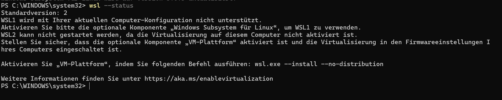

*Figure 2: WSL status after Windows recovery, indicating unavailable virtualization support.*

Further investigation showed:

| Component | Observed Status |
|:---|:---|
| Default WSL version | 2 |
| Hardware virtualization (Task Manager) | Enabled |
| VirtualMachinePlatform | Disabled |
| Microsoft-Windows-Subsystem-Linux | Disabled |

The optional Windows features were checked using DISM:

```powershell
dism /online /Get-Features /Format:Table
```

An earlier attempt to query an individual feature returned error `0x800f080c`. The complete feature listing was subsequently used to inspect the component states.

## 2.3 Decision

Due to the previous boot failure and the limited time available for A2, the local WSL installation was not repeated.

Instead, GitHub Codespaces was selected as an alternative Linux environment. This avoided further modifications to the Windows system while preserving access to a full development terminal.

---

# 3. Alternative Setup – GitHub Codespaces

A GitHub Codespace was created directly from the existing project repository.

The operating system was verified using:

```bash
cat /etc/os-release
```

The resulting environment was:

| Parameter | Value |
|:---|:---|
| Platform | GitHub Codespaces |
| Operating System | Ubuntu 24.04.5 LTS |
| Distribution Codename | Noble Numbat |
| Simulator Version | ns-3.46 |
| System Python | 3.12.3 |

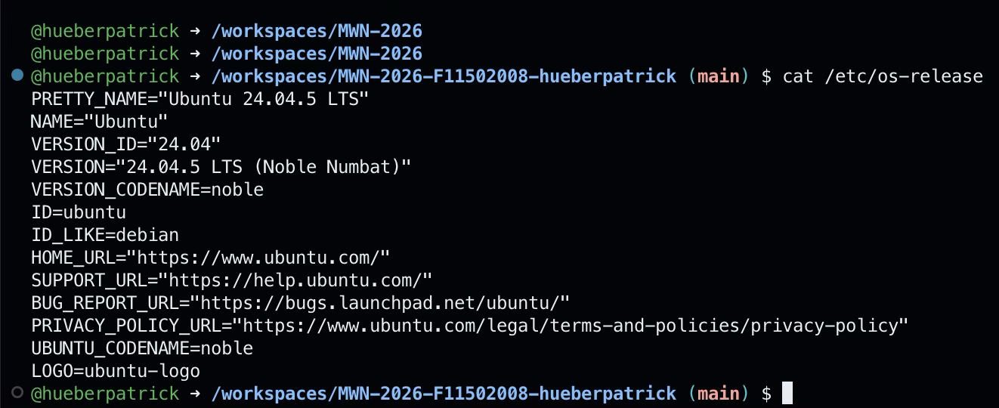

*Figure 3: Successful initialization of Ubuntu 24.04.5 LTS in GitHub Codespaces.*

This approach allowed development to continue through a browser, including access from an iPad.

## 3.1 Installing Dependencies

The required development tools were installed using:

```bash
sudo apt update && sudo apt install -y \
  git g++ python3 python3-pip cmake ninja-build pkg-config
```

The installation completed successfully.

## 3.2 Downloading ns-3

A fixed ns-3 release was downloaded from the official GitLab repository:

```bash
cd ~

git clone --branch ns-3.46 --depth 1 \
  https://gitlab.com/nsnam/ns-3-dev.git ns-3
```

Git displayed a `detached HEAD` notification because a specific release tag was checked out. This was expected and did not indicate an installation failure.

---

# 4. Python Compatibility Issue

The initial ns-3 configuration command was:

```bash
./ns3 configure --enable-examples
```

This command failed with a Python `argparse` exception:

```text
ValueError: action 'store_true' is not valid for positional arguments
```

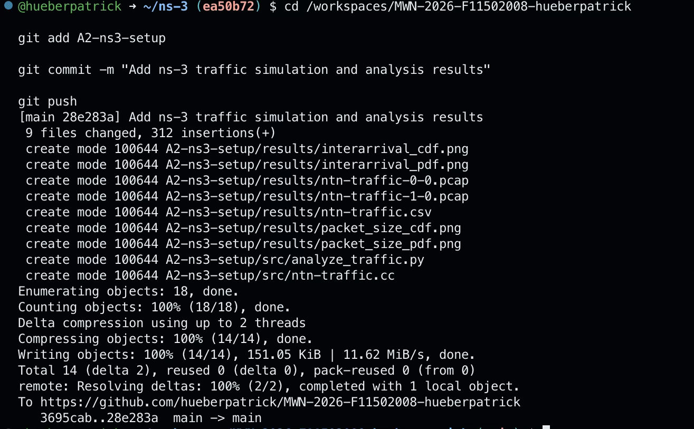

*Figure 4: Initial ns-3 configuration failure caused by the default Python environment.*

Investigation showed that the Codespaces environment was using Python 3.14 by default, while Ubuntu's system Python was version 3.12.3.

The configuration was therefore repeated explicitly using the system Python interpreter:

```bash
/usr/bin/python3 ./ns3 configure --enable-examples
```

This resolved the issue.

The successful configuration reported:

```text
-- Configuring done
-- Generating done
-- Build files have been written to:
   /home/codespace/ns-3/cmake-cache
```

Some optional modules were unavailable, including MPI, OpenFlow, and the visualizer. These modules were not required for the initial simulation.

---

# 5. Building and Testing ns-3

The simulator was compiled using:

```bash
/usr/bin/python3 ./ns3 build -j 2
```

After reconnecting to Codespaces, the build was checked by running the same command again.

Ninja reported:

```text
ninja: no work to do.
```

This confirmed that no additional compilation steps were pending.

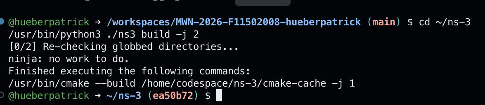

*Figure 5: Successful ns-3 build verification using Ninja.*

## 5.1 Built-in Example

The first functional test was performed using:

```bash
/usr/bin/python3 ./ns3 run first
```

The simulation successfully exchanged packets between a client and a server.

Selected output:

```text
At time +2s client sent 1024 bytes
At time +2.00369s server received 1024 bytes
At time +2.00737s client received 1024 bytes
```

The example demonstrated successful execution of the ns-3 simulation engine.

The observed client-to-server delay was approximately **3.69 ms**, while the round-trip time was approximately **7.37 ms**.

These values refer to the built-in example and are not measurements of the custom NTN traffic model.

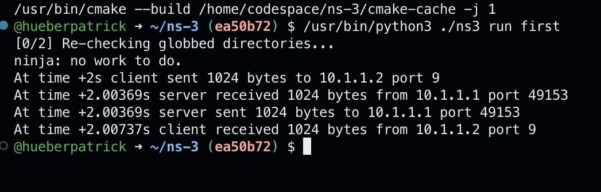

*Figure 6: Successful execution of the built-in ns-3 first example.*

---

# 6. Custom Traffic Model

A custom C++ simulation was implemented to generate variable UDP traffic.

**Source file:** [`src/ntn-traffic.cc`](src/ntn-traffic.cc)

The simulation consists of two nodes connected through a point-to-point link.

## 6.1 Network Configuration

| Parameter | Configuration |
|:---|:---|
| Number of Nodes | 2 |
| Transport Protocol | UDP |
| Data Rate | 10 Mbps |
| Link Propagation Delay | 10 ms |
| Sender IP | 10.1.1.1 |
| Receiver IP | 10.1.1.2 |
| Destination Port | 9000 |
| Generated Packets | 100 |
| Random Seed | 12345 |

## 6.2 Traffic Characteristics

The traffic generator uses three possible application payload sizes:

- 200 bytes
- 600 bytes
- 1200 bytes

Packet sizes are selected randomly with equal configured probability.

The inter-arrival times follow an exponential distribution with a configured mean of 50 ms.

The traffic model is an initial, simplified stochastic prototype intended to demonstrate traffic generation and statistical verification.

**It is not presented as a validated implementation of the complete 3GPP TS 26.926 traffic model.**

The implementation provides a reproducible foundation for later refinement and integration into the NTN simulation.

## 6.3 Executing the Simulation

The source code was copied into the ns-3 `scratch` directory and executed using:

```bash
/usr/bin/python3 ./ns3 run scratch/ntn-traffic
```

The simulation completed successfully and produced the following output:

```text
Packets generated: 100
Total application bytes received: 71800
Simulation completed successfully.
```

The total application payload received was **71,800 bytes**.

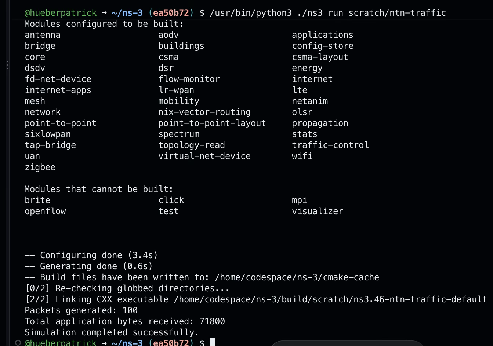

*Figure 7: Successful execution of the custom ns-3 traffic generator, confirming the generation of 100 packets and reception of 71,800 application bytes.*

---

# 7. Generated Simulation Results

The custom simulation produced three primary output files:

| File | Description |
|:---|:---|
| [`ntn-traffic.csv`](results/ntn-traffic.csv) | Packet sizes and generated inter-arrival times |
| [`ntn-traffic-0-0.pcap`](results/ntn-traffic-0-0.pcap) | Packet capture at the sender-side device |
| [`ntn-traffic-1-0.pcap`](results/ntn-traffic-1-0.pcap) | Packet capture at the receiver-side device |

The CSV file records the packet index, transmission timestamp, application payload size, and generated inter-arrival time.

The first inter-arrival entry is zero because it represents the initial scheduled transmission rather than an interval between two consecutive packets. It is excluded from the inter-arrival distribution analysis.

---

# 8. PDF and CDF Verification

A Python analysis script was created to evaluate the generated simulation data.

**Source file:** [`src/analyze_traffic.py`](src/analyze_traffic.py)

The script reads the CSV file and produces four diagrams.

## 8.1 Packet Size – Empirical PDF

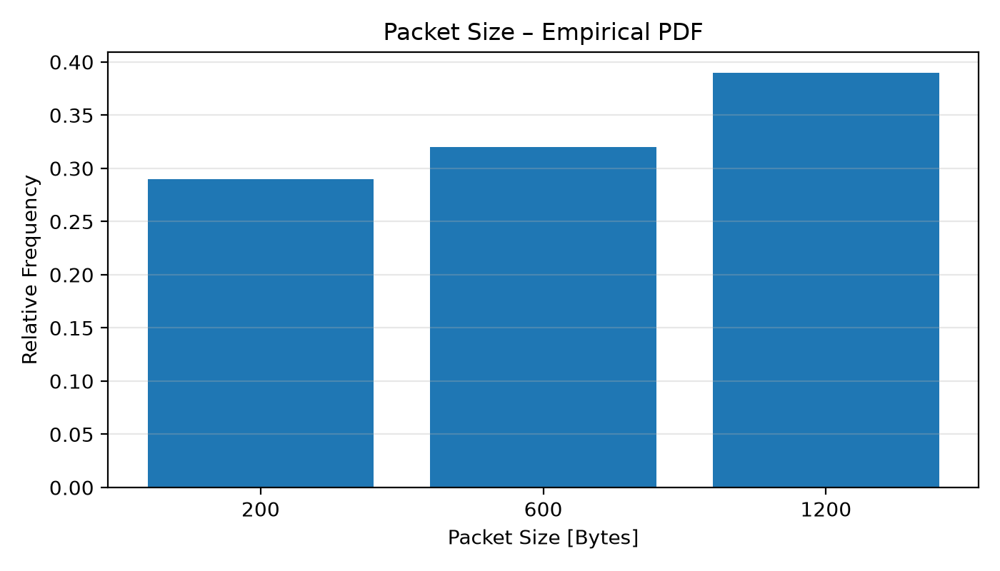

*Figure 8: Empirical probability distribution of the generated application payload sizes.*

The plot represents the relative frequency of the three configured packet sizes.

For this discrete distribution, the plotted values are technically a probability mass function (PMF), presented as the assignment's requested packet-size PDF.

## 8.2 Packet Size – Empirical CDF

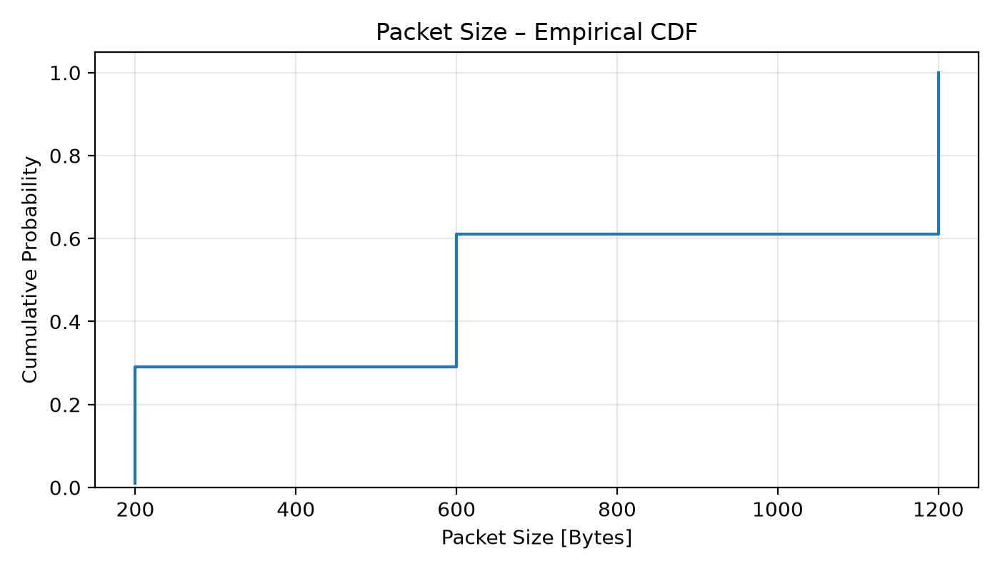

*Figure 9: Empirical cumulative distribution of the generated packet sizes.*

The empirical cumulative distribution shows the proportion of generated packets whose payload size is less than or equal to a given value.

## 8.3 Inter-Arrival Time – Empirical PDF

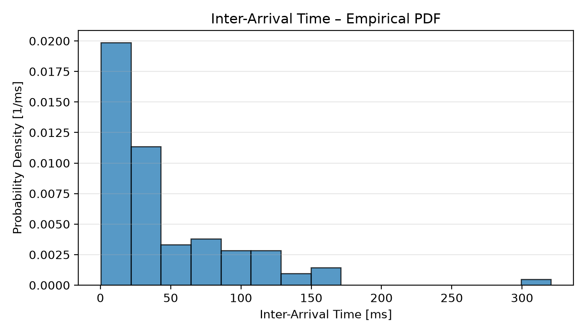

*Figure 10: Density-normalized histogram of the generated packet inter-arrival times.*

A density-normalized histogram was generated from the 99 inter-arrival times between consecutive packets.

The distribution is expected to exhibit the characteristic shape of an exponential random variable.

## 8.4 Inter-Arrival Time – Empirical CDF

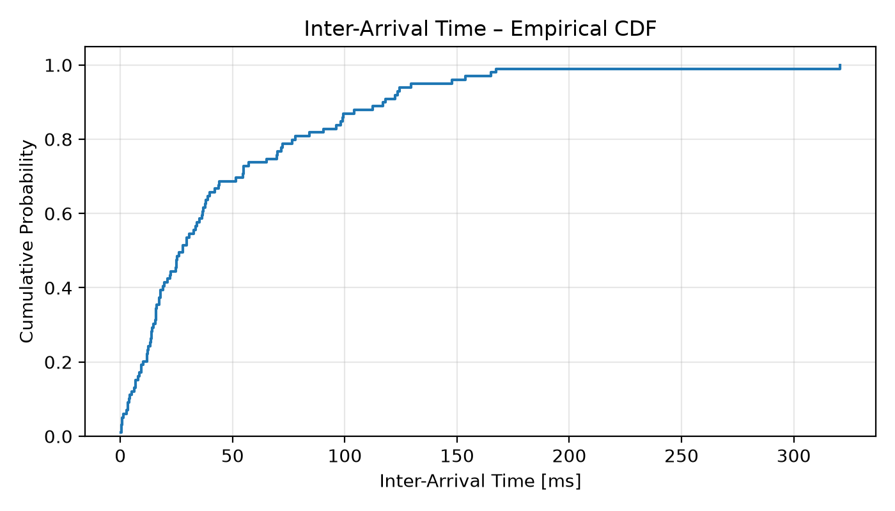

*Figure 11: Empirical cumulative distribution of the generated inter-arrival times.*

The empirical CDF shows the cumulative probability of the generated inter-arrival times.

These diagrams provide an initial statistical verification of the implemented traffic generator. A formal comparison against the requirements of a specific 3GPP traffic profile remains future work.

---

# 9. PCAP Verification Using Wireshark

The generated packet capture was downloaded from GitHub and opened in Wireshark on a separate Windows laptop.

The following display filter was applied:

```text
udp.port == 9000
```

Wireshark displayed exactly **100 UDP packets**, matching the number generated by the custom simulation.

The packet capture confirmed:

| Property | Observed Value |
|:---|:---|
| Source IP | 10.1.1.1 |
| Destination IP | 10.1.1.2 |
| Transport Protocol | UDP |
| Destination Port | 9000 |
| Displayed Packets | 100 |
| Application Payload Sizes | 200, 600, and 1200 bytes |

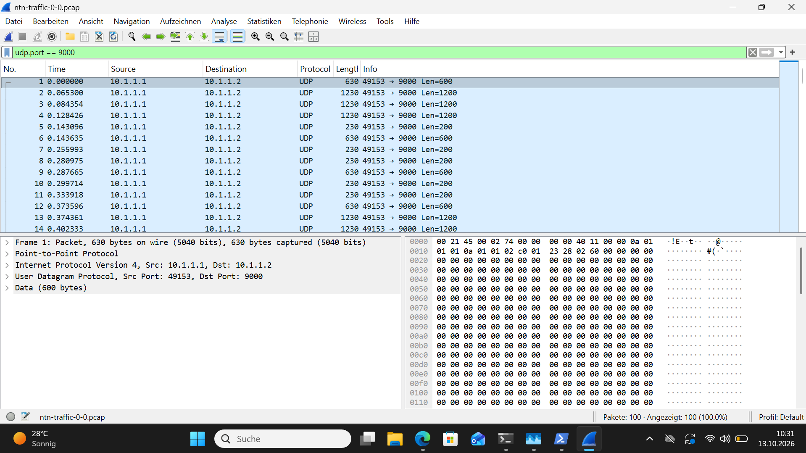

*Figure 12: Verification of the custom ns-3 traffic model in Wireshark. The applied display filter shows exactly 100 UDP packets transmitted from 10.1.1.1 to 10.1.1.2.*

The Wireshark packet-length column includes protocol overhead. For example, a 600-byte application payload appears as a 630-byte captured frame due to the additional protocol headers.

---

# 10. Problems Encountered and Solutions

| Problem | Resolution / Decision |
|:---|:---|
| Windows failed to boot after initial WSL installation | Windows system reset was required |
| WSL installation reported corruption after recovery | WSL repair was performed |
| WSL2 could not start due to unavailable virtualization environment | Windows component states were investigated |
| Repeating the local installation presented additional risk | Migrated to GitHub Codespaces |
| ns-3 configuration failed under Python 3.14 | Used Ubuntu system Python 3.12.3 |
| Codespaces session was interrupted during compilation | Re-ran the incremental build and verified completion |
| Simulator results initially existed outside the GitHub repository | Copied source code and results into the A2 project directory |

---

# 11. Current Limitations

The current implementation establishes a working simulation and traffic-analysis workflow. However, it does not yet represent a complete 5G NTN system.

The following components remain outside the scope of this initial prototype:

- A validated 3GPP TS 26.926 traffic profile.
- Satellite-specific channel and propagation models.
- LEO and GEO orbital characteristics.
- A complete 5G NR protocol stack.
- Comparative QoS analysis under varying network conditions.
- Comprehensive measurement of latency, jitter, throughput, and packet delivery ratio.

These limitations are acknowledged to distinguish the completed A2 work from the objectives of the final project.

---

# 12. Conclusion

The initial local installation approach encountered a significant system-level failure and could not be completed safely within the available timeframe.

Migrating to GitHub Codespaces provided a practical alternative that allowed the project to continue without further changes to the local Windows installation.

Despite the initial difficulties, the following milestones were achieved:

- Successful installation and compilation of ns-3.46.
- Successful execution of a built-in ns-3 example.
- Implementation and execution of a custom UDP traffic generator.
- Generation of 100 packets and reception of 71,800 application bytes.
- Export of CSV and PCAP simulation results.
- Generation of packet-size and inter-arrival-time PDF/CDF diagrams.
- Successful verification of all 100 UDP packets in Wireshark.
- Version-controlled storage of source code and results in GitHub.

The resulting environment and code provide a foundation for the subsequent development of the 5G NTN QoS simulation.

---

# 13. Repository Structure

```text
A2-ns3-setup/
│
├── study-note.md
│
├── src/
│   ├── ntn-traffic.cc
│   └── analyze_traffic.py
│
├── results/
│   ├── ntn-traffic.csv
│   ├── ntn-traffic-0-0.pcap
│   ├── ntn-traffic-1-0.pcap
│   ├── packet_size_pdf.png
│   ├── packet_size_cdf.png
│   ├── interarrival_pdf.png
│   └── interarrival_cdf.png
│
└── screenshots/
    ├── 01-wsl-installation.png
    ├── 02-wsl-error.png
    ├── 03-codespaces-ubuntu.png
    ├── 04-python-error.png
    ├── 05-ns3-build.png
    ├── 06-first-simulation.png
    ├── 07-custom-simulation.png
    └── 08-wireshark.png
```

---

**End of A2 Technical Study Notes**

